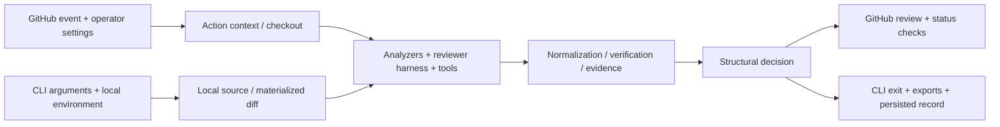

# mergeCraft repository audit — 2026-11-05

Audited source: [`55cf88e33c318a8b03a251fb0f8b6dad9d999141`](https://github.com/alexhawat/mergeCraft/commit/55cf88e33c318a8b03a251fb0f8b6dad9d999141), main at the start of this audit. Package metadata: `mergecraft-action 0.1.0a4`. This is a fresh audit, with current executions and reconciliation of earlier findings.

This document preserves the audit-time assessment. For subsequent fixes and their verification, see the [five-PR remediation record](audit-remediation-2026-11-05.md).

## Verdict

**It works on meaningful paths, and the engineering has improved substantially. It is a capable alpha, but I would not yet use its approval check as the sole authority to merge.**

This is more than a prompt wrapper. The repository implements real provider dispatch, analyzer ingestion, trust controls, evidence packets, policy enforcement, terminal review submission, CLI source selection, and publication. Current hosted CI passed 14,138 parameterized unit cases on Python 3.14. The exact audited source has 87.91% statement coverage and 77.58% branch coverage. A recent installed OpenCode harness completed a real provider-backed offline review. These are concrete positive results.

The remaining defects concern the meaning of the result. An approval can be posted to a newer commit than the one reviewed; a head-side configuration can replace pinned run budgets; finding normalization can erase a blocking finding or its location. New probes show semantic code changes being classified as safe whitespace, required policies missing paths containing spaces, and CLI workspace/toolchain mismatches. Those failures matter more than another few percentage points of coverage.

**Testing is broad and often thoughtful, but its strongest coverage is within components. Cross-component identity, adverse combinations, installation isolation, and assertion correctness are weaker.** Two test mechanisms themselves accept incorrect outcomes. Model detection quality remains a separate question: neither these unit results nor the observed live smoke establishes competitive precision or recall.

There are **nine newly identified findings** below, separate from reconfirmed earlier defects and assurance gaps. No listed new finding duplicates the current open issues/PRs reviewed for this audit. The findings are not a claim of exhaustive absence of other bugs.

| Dimension | Assessment |
|---|---|
| Core engineering | Substantial typed architecture and explicit invariants; complicated state handoffs remain error-prone. |
| GitHub Action | Useful and increasingly hardened; revision binding at checkout and final approval still needs repair. |
| CLI | Useful review core and rich inputs/exports; workspace, environment, output-error and installed-toolchain semantics are uneven. |
| Security | Serious defense in depth, with documented limits; not a universal isolation boundary for hostile code. |
| Tests | Strong breadth, credible behavioral tests, and improving integration; incomplete coverage of composition and real deployment. |
| Review quality | Not established by an independent, comparable detection campaign in the evidence inspected here. |
| Product position | Most attractive to operators who want inspectable, self-operated policy and evidence with model choice. |
| Recommended use | Supervised/advisory review today; strengthen the decision and artifact boundaries before relying on unattended enforcement. |

## Scope, evidence and open-work exclusions

The original workspace at `<original-desktop-workspace>` returned OS-level “Operation not permitted,” including for read-only Git access. Therefore this audit uses a fresh GitHub checkout at:

`<audit-checkout>`

**Local uncommitted changes in the original workspace were not audited.** All source findings are tied to the exact commit above, not to a moving branch or the published alpha image. The source was not edited. Only audit documents and reproducers were added under `plans/`. No issues, comments, PRs, commits, releases, deployments, or provider jobs were created.

I read the current open issue/PR bodies and refreshed the inventory before writing the report. The snapshot has **14 issues and 16 PRs**, retained in [the open-work snapshot](audit-2026-11-05-open-work.json). Per the request, this report assumes their work is completed and does not count it as new remediation:

- [#1169](https://github.com/alexhawat/mergeCraft/issues/1169): stale self-review Action pin; [#1162](https://github.com/alexhawat/mergeCraft/issues/1162): current advisory/image promotion work.
- [#1163–#1166](https://github.com/alexhawat/mergeCraft/pull/1167) / PR #1167: incident cases, comparison rescoring, human outcomes and review-round limits.
- [#1056](https://github.com/alexhawat/mergeCraft/issues/1056) / [PR #1160](https://github.com/alexhawat/mergeCraft/pull/1160): unknowns, lane reasons, declared scope and fail-then-pass proof. The parser finding below affects existing policy matching independently.
- [#1031](https://github.com/alexhawat/mergeCraft/issues/1031): file-group fanout; its implementation is already in this checkout via PR #1157.
- [#860](https://github.com/alexhawat/mergeCraft/issues/860), [#859](https://github.com/alexhawat/mergeCraft/issues/859), [#780](https://github.com/alexhawat/mergeCraft/issues/780), [#736](https://github.com/alexhawat/mergeCraft/issues/736), [#735](https://github.com/alexhawat/mergeCraft/issues/735), [PR #865](https://github.com/alexhawat/mergeCraft/pull/865): language fixtures, trajectory harvesting, independent labels and calibration.
- [#1151](https://github.com/alexhawat/mergeCraft/issues/1151): root-layout cleanup; [PR #1161](https://github.com/alexhawat/mergeCraft/pull/1161): Agents SDK embedding.
- PRs #1154, #1142, #1090, #1079, #1067, #1066, #1065, #1063, #1057, #1042, #1041 and #949: dependency upgrades and cleanup, also excluded.

Assuming that code work lands is not the same as assuming its eventual benchmark results. I do not repeat the already-tracked evaluation work as a new bug, and I do not invent accuracy scores for it.

Verification combined current source inspection, actual Git-generated fixtures, in-memory HTTP/SCM/process boundary probes, 122 selected existing local tests, exact-commit hosted CI and coverage artifacts, and current official competitor documentation. The local runtime was an existing Python 3.14 environment; cached pytest was made available without installation for the selected synchronous tests. This was not a new full lockfile-environment test run.

## What now works better

Several earlier criticisms are obsolete and should be retired:

| Earlier concern | Current finding |
|---|---|
| Integration green through a file-presence sentinel | Fixed. The exact-commit ordinary integration lane ran 19 real cases, with eight skips; a separate privileged lane ran another ten checks. |
| CodeQL errors ignored | Fixed in the current workflow; the current exact-commit CodeQL run succeeded. |
| Default local review misses untracked additions | Fixed for eligible files. New omission/accounting defects remain in N4/N5. |
| Indexed provider credentials evade the fork guard | Fixed by canonical credential enumeration and settings-aware enforcement. |
| Indexed Codex subscription credentials fail to reach isolated auth | Fixed in the current resolved-credential path. |
| Local roster requires GitHub workflow wiring | Fixed; workflow-wiring enforcement is now limited to GitHub Actions. |
| `get_commit_info` replaces the canonical PR diff | Fixed; the artifact is now inspection-only. |
| One partial analyzer rerun replaces all previous scopes | Largely fixed with scope segments. Their union still has a severity-loss corner case, R3. |
| Core clustering chooses weaker severity by tool name | Fixed for the severity field. Causality and the separate scope-union merge remain unsafe, R3. |
| Unknown comment/dispatch PR identity receives trust | Substantially hardened with target binding and refusal on failed binding. Same-repository fork detection is still wrong. |
| Release preparation cannot trigger the downstream build | Explicit dispatch now exists. |
| Release metadata drifts across version files | Version-update plumbing now reconciles the metadata. |
| Pinned Craft wrapper installs an unrelated latest executable | Fixed at the currently pinned upstream resolver. |
| Only one fixed test order ever runs | A current nightly varying-seed run passed. |
| No wheel acceptance at all | Partially fixed: a release-wheel convergence check exists, but does not establish a clean installed CLI environment. |

This is material progress. The remaining failures should be fixed without discarding the working evidence, trust and test infrastructure.

## Architecture and GitHub Action versus CLI

The Action path converges on `main.py`; the local path uses `offline_review.py` and `review/offline_agent.py`. Both feed typed findings, verification, evidence and decision logic, but they assemble source, authority and settings separately. Most findings in this audit appear where those separately assembled contexts are joined.

| Capability | Action | CLI | Assessment |
|---|---|---|---|
| Source selection | Bound PR/event and fetched checkout | Working tree, staged/unstaged, ranges, patches and remote repositories | CLI is more flexible; some selectors do not bind the inspected tree to the requested revision. |
| Configuration | Base/operator settings and run snapshots | Committed config, local overlay, process environment, flags | Useful distinction, but hydration/validation/target-directory inconsistencies undermine it. |
| Credentials | Workflow/provider wiring and fork restrictions | Local environment and provider authentication | Local roster validation now correctly skips workflow-wiring enforcement outside Actions. |
| Review core | Harnesses, analyzers, verification and evidence | Largely shared core | Shared algorithms do not guarantee identical source or authority. |
| Fast path and fanout | Current server orchestration supports them, opt-in | No equivalent fanout orchestration found in the local reviewer path | Document this explicitly; not reported as a bug because the feature is described as server-side. |
| Evidence | GitHub checks/artifacts and policy producers | Local evidence and optional coverage/mutation | CLI coverage tool selection is broken in a common isolated-install arrangement. |
| Publication | Formal reviews, checks and receipts | Text/JSON/JSONL/SARIF and local records | Both have useful outputs; revision binding and error exit behavior need repair. |
| Browser verification | Trust-gated optional path | Standalone `verify-behavior` | Target-repository selection is not respected consistently. |
| Installation | Container image and pinned consumer Action | Python wheel or source install with external harnesses | Source, wheel, image and consumer pin are distinct deliverables. |

The new lite path has a restricted single-call design; it does not run the full reviewer/tools/verifier chain. The code deliberately makes successful skip/lite decisions neutral rather than ordinary approval. The fanout feature is bounded and disabled by default. These limits are sensible. Neither feature should be described as providing the same assurance as a full completed review.

## New findings

P1 means a high-impact correctness/security boundary; P2 is a consequential functional defect; P3 is lower-impact tooling. Effort is relative: S = localized, M = several cooperating paths. Confidence is high for all nine findings; N9 is source-confirmed rather than an actual ARM runner execution. “Risk” refers to changing the implementation.

### N1 — P2: whitespace triage skips changes to runtime values and executable metadata

**Evidence:** [src/mergecraft/classify/triage.py:384](https://github.com/alexhawat/mergeCraft/blob/55cf88e33c318a8b03a251fb0f8b6dad9d999141/src/mergecraft/classify/triage.py#L384), normalization at line 404, metadata parsing at line 193.

With the base-owned fast path enabled and `whitespace` opted into `skipLlm`, the recognizer strips line-end whitespace and empty lines without tracking string-literal context. The retained probe shows:

- Removing two spaces inside a Python triple-quoted string changes the value, verified with Python AST literal evaluation, but yields `tier=skip`.
- Removing a blank line inside that string also changes the value and yields `skip`.
- Removing indentation inside a TypeScript template literal yields `skip`.
- A shell file losing its executable bit, combined with an otherwise harmless whitespace hunk, yields `skip`; the parser ignores the mode metadata once a hunk is present.

**Impact:** meaningful code changes can receive no full LLM review after being described as whitespace-only. This is opt-in and is **not proof of automatic approval**: [src/mergecraft/evidence/run_packet.py:423](https://github.com/alexhawat/mergeCraft/blob/55cf88e33c318a8b03a251fb0f8b6dad9d999141/src/mergecraft/evidence/run_packet.py#L423) neutralizes successful skip/lite decisions. The defect is false classification and missing review.

**Why tests miss it:** existing fixtures cover inline string spacing, Python indentation and pure metadata-only diffs; they do not combine multiline literal state or mode changes with an accepted hunk. All 82 recognizer tests passed locally alongside these reproducers.

**Repair/acceptance:** require lexical proof appropriate to the language or fall back to full review; reject meaningful metadata transitions even when hunks exist. Add the four examples as negative cases, plus equivalence tests for genuinely harmless whitespace. **Effort M; risk MED.**

### N2 — P2: deleting YAML front matter is classified as prose-only

**Evidence:** [src/mergecraft/classify/triage.py:296](https://github.com/alexhawat/mergeCraft/blob/55cf88e33c318a8b03a251fb0f8b6dad9d999141/src/mergecraft/classify/triage.py#L296), especially the head-only check at lines 311–324.

Delete the complete front matter from a Markdown file containing `permalink` and `published` metadata, leaving its body unchanged. The real triage function returns `tier=skip, recognizer=prose`. Because the head file has no front matter, the deleted region is never recognized as metadata.

**Impact:** routing/publishing metadata changes can lose the full review reserved for non-prose changes. As in N1, fast path must be enabled; the finding is not an approval bypass claim.

**Repair/acceptance:** inspect old and new structural state, or conservatively reject deletions that could remove front matter. Test whole-block deletion, delimiter deletion and partial metadata edits. Existing tests for edits within surviving front matter do not cover this transition. **Effort S–M; risk LOW–MED.**

### N3 — P2: no-hunk paths containing spaces disappear from required policy matching

**Evidence:** [src/mergecraft/utils/diff_paths.py:13](https://github.com/alexhawat/mergeCraft/blob/55cf88e33c318a8b03a251fb0f8b6dad9d999141/src/mergecraft/utils/diff_paths.py#L13), lines 101–103 and 130–138; consumer [src/mergecraft/policy/review.py:1160](https://github.com/alexhawat/mergeCraft/blob/55cf88e33c318a8b03a251fb0f8b6dad9d999141/src/mergecraft/policy/review.py#L1160).

A real temporary Git repository generated mode-only, binary-only and pure-rename diffs with paths such as `scripts/deploy job.sh`. Git emitted valid unquoted headers containing spaces. The regex requires unquoted paths to match `\S+`, so those headers disappear. The unspaced control path survives.

A required policy for the changed deployment script produced **zero rows** using the parsed path list. Supplying the actual changed path produced the expected **Major finding** for missing rollback evidence.

The same helper is used to prove an artifact producer's workflow is unchanged. A mode change to a workflow with a space in its name was accepted as untouched. This shows an incomplete predicate, **not** an executed changed workflow body or a demonstrated complete artifact forgery.

**Repair/acceptance:** centralize Git path decoding; preserve both rename paths and generic paths without hunks; use structured NUL-delimited path data where available. An unparseable header must not certify absence of protected changes. Test actual Git output, not only hand-written space-free headers. **Effort S–M; risk MED.**

### N4 — P2: an unchanged repository with normal ignored files becomes inconclusive

**Evidence:** [src/mergecraft/utils/offline_diff.py:163](https://github.com/alexhawat/mergeCraft/blob/55cf88e33c318a8b03a251fb0f8b6dad9d999141/src/mergecraft/utils/offline_diff.py#L163), default materialization at line 289; [src/mergecraft/offline_review.py:858](https://github.com/alexhawat/mergeCraft/blob/55cf88e33c318a8b03a251fb0f8b6dad9d999141/src/mergecraft/offline_review.py#L858).

A clean Git repository with a committed `.gitignore` and ordinary ignored `.venv/installed` had empty `git status --porcelain`. Actual `review --cwd ... --base main --dry-run` exited **20**, saying every change was excluded and listing `.venv/` as a review limitation.

**Impact:** normal dependency/build/environment contents prevent a clean empty-diff result. This is an overcorrection of the earlier untracked-source omission.

**Repair/acceptance:** distinguish ignored workspace contents from eligible changed source that was deliberately omitted. Preserve limitations for oversized eligible source, without treating every ignored artifact as a change. Test a clean consumer checkout with virtualenv, build cache and ignored environment files. One current test explicitly expects ignored paths to become limitations; update the intended invariant first. **Effort S–M; risk MED.**

### N5 — P2: explicit unstaged review discards omission metadata and can report passed

**Evidence:** [src/mergecraft/utils/offline_diff.py:246](https://github.com/alexhawat/mergeCraft/blob/55cf88e33c318a8b03a251fb0f8b6dad9d999141/src/mergecraft/utils/offline_diff.py#L246), particularly line 252; [src/mergecraft/utils/source_resolve.py:557](https://github.com/alexhawat/mergeCraft/blob/55cf88e33c318a8b03a251fb0f8b6dad9d999141/src/mergecraft/utils/source_resolve.py#L557).

For a repository whose only addition is an oversized untracked Python source file, `--unstaged` materialization returns an empty diff with no coverage limitations. The real empty-diff review path returns **success=true, outcome=passed**. The discovery function knows the file was excluded; its caller discards that information.

**Impact:** omitted oversized, binary, non-UTF-8 or symlink additions can disappear from this mode's outcome. The explicit mode is less honest than the newly repaired default path.

**Repair/acceptance:** propagate structured materialization metadata through every source selector. An omission of eligible changed source must remain visible and affect the outcome consistently. Test selector → materialization → final result, not merely that binary input does not crash. **Effort S; risk LOW.**

### N6 — P2: browser verification ignores the input's repository for startup and policy

**Evidence:** [src/mergecraft/cli/verify_behavior_cmd.py:332](https://github.com/alexhawat/mergeCraft/blob/55cf88e33c318a8b03a251fb0f8b6dad9d999141/src/mergecraft/cli/verify_behavior_cmd.py#L332), settings at line 346; [src/mergecraft/verify/runner.py:185](https://github.com/alexhawat/mergeCraft/blob/55cf88e33c318a8b03a251fb0f8b6dad9d999141/src/mergecraft/verify/runner.py#L185) and line 550.

A valid `VerificationInput` names repository B, with `startup_command="python app.py"`, while the caller is in A. The runner passes no `cwd` to the subprocess, so it inherits A. The CLI separately loads settings from A. The retained probe intercepts the actual subprocess boundary; it does not launch an application/browser.

**Impact:** the wrong app can start or fail, and B's `shell`/`verify_behavior.enabled` policy is not the policy consulted. The input model requires `repo_path`; documentation enumerates it but does not explain this surprising restriction.

**Repair/acceptance:** resolve the target workspace once and use it for policy, startup and repository-relative inputs; define relative-path resolution explicitly. Test two repositories with distinguishable startup behavior and opposite verification settings. Existing lifecycle tests use an absolute script path, masking the directory error. **Effort S–M; risk MED.**

### N7 — P2: local coverage detects the consumer tool, then runs the CLI's Python instead

**Evidence:** [src/mergecraft/ci/local_evidence.py:275](https://github.com/alexhawat/mergeCraft/blob/55cf88e33c318a8b03a251fb0f8b6dad9d999141/src/mergecraft/ci/local_evidence.py#L275), execution at lines 333–344 and export at 359–369.

Availability accepts a `coverage` executable found on PATH. Execution ignores that executable and runs `sys.executable -m coverage ... -m pytest`. In the recommended isolated `uv tool` installation shape, this is mergeCraft's environment, not the consumer test environment.

The recorded invocation bypassed a discovered `/consumer/.venv/bin/coverage`. The existing CLI interpreter used for this audit has neither coverage nor pytest. The process failure was simulated; consumer tests were not executed.

**Impact:** `--with-coverage` can produce no evidence even when the consumer's test toolchain is configured. If the CLI environment has coverage, it may still lack the consumer's application dependencies. This is conditional on environment separation, not a claim that every invocation fails.

**Repair/acceptance:** select one consumer toolchain and use it consistently for both execution and export, preserving sandbox controls. Test an installed CLI environment distinct from a consumer virtualenv. **Effort M; risk MED.**

### N8 — P2: GitHub Enterprise GraphQL uses the REST endpoint prefix

**Evidence:** [src/mergecraft/utils/github.py:196](https://github.com/alexhawat/mergeCraft/blob/55cf88e33c318a8b03a251fb0f8b6dad9d999141/src/mergecraft/utils/github.py#L196) and [src/mergecraft/utils/github.py:394](https://github.com/alexhawat/mergeCraft/blob/55cf88e33c318a8b03a251fb0f8b6dad9d999141/src/mergecraft/utils/github.py#L394).

With REST base `https://ghe.example/api/v3`, the actual HTTP client constructs `https://ghe.example/api/v3/graphql`. GitHub documents `https://HOSTNAME/api/graphql` as the GHES GraphQL endpoint. [Official endpoint reference](https://docs.github.com/en/enterprise-server@3.20/graphql/guides/forming-calls-with-graphql#the-graphql-endpoint).

**Impact:** GraphQL-backed operations, including closing-issue requirement discovery, fail in this configuration. The requirement producer fails closed; this is availability/compatibility, not credential disclosure. The source explicitly claims GHES environment support, although broader end-to-end GHES parity is incomplete.

**Repair/acceptance:** separate REST and GraphQL endpoints, honoring `GITHUB_GRAPHQL_URL` or a correct transformation. Assert real request URLs through MockTransport for public GitHub, GHES and test servers. Current tests check only the REST base property. **Effort S; risk LOW–MED.**

### N9 — P3: ARM64 workflow lint uses an amd64 checksum

**Evidence:** [scripts/workflow_lint.sh:9](https://github.com/alexhawat/mergeCraft/blob/55cf88e33c318a8b03a251fb0f8b6dad9d999141/scripts/workflow_lint.sh#L9), architecture selection at 22–24 and verification at 36–38.

The script accepts Linux ARM64 and selects its actionlint archive, then compares it with the one hardcoded amd64 digest. A fresh ARM64 installation therefore fails checksum validation. The companion zizmor branch instead omits verification on ARM64, despite the header describing pinned downloads.

**Repair/acceptance:** supply verified per-architecture digests for both tools, or explicitly reject unsupported architectures. Unit-test URL/digest selection and add a real smoke for supported architectures. This audit did not download the ARM archives or run an ARM Linux host. **Effort S; risk LOW.**

## Earlier defects that remain, including partial fixes

These are **not counted as nine new discoveries**. They were rechecked against current source; “runtime” means a current retained probe, while “source” means the current control flow was inspected without executing the complete scenario.

### R1 — P1: approval success can attach to an unreviewed newer head

At [src/mergecraft/utils/status_checks.py:324](https://github.com/alexhawat/mergeCraft/blob/55cf88e33c318a8b03a251fb0f8b6dad9d999141/src/mergecraft/utils/status_checks.py#L324), finalization fetches the current PR head. Completion is correctly posted using the checked-out SHA at line 340; approval is posted using the freshly fetched head at line 494.

The recording-client probe reviewed A and returned current head B. It recorded **`mergecraft: success` on A and `mergecraft-approval: success` on B**. No review of B happened. The probe supplies an already-decided packet, so it tests publication binding rather than assuming an empty review should approve.

If a consumer requires only the approval check, this can greenlight unreviewed code. Requiring completion too can prevent that merge, but does not make the approval claim correct. A current test explicitly expects this newer-head behavior.

**Repair:** bind completion, approval, packet and formal review to one immutable reviewed SHA; a moved head must not inherit success. Test a push between review and finalization for all conclusion branches. **Runtime proof; high confidence; effort S; risk LOW–MED.**

### R2 — P1/P2: head YAML replaces pinned operator run bounds

[src/mergecraft/mcp/review_context.py:42](https://github.com/alexhawat/mergeCraft/blob/55cf88e33c318a8b03a251fb0f8b6dad9d999141/src/mergecraft/mcp/review_context.py#L42) reloads settings from the checked-out tree and replaces live budget bounds, even when an operator-owned snapshot exists.

The untrusted-context probe starts with token budget **100** and a head setting of **1,000,000**. Hydration leaves the snapshot at 100 but changes the live tracker to 1,000,000. A PR can also lower a limit to force premature termination. Spend impact depends on credentials and any environment-level constraints.

**Repair:** derive bounds from the pinned snapshot and the intended round multiplier; head content must not widen or shrink the operator's authority. Test all limit fields in both directions. **Runtime proof; high confidence; effort S; risk LOW.**

### R3 — P1: preserving severity alone does not preserve a blocker

Two separate merging stages still weaken stronger evidence:

1. **Cluster causality:** [src/mergecraft/analyzers/cluster.py:110](https://github.com/alexhawat/mergeCraft/blob/55cf88e33c318a8b03a251fb0f8b6dad9d999141/src/mergecraft/analyzers/cluster.py#L110) preserves strongest severity but copies `introduced_by_pr` from the preferred wording member. Using the real base-comparison and suppression functions, the probe produces a new Major and pre-existing Minor at the same location/message but different rules. Both survive on the touched file. Major alone blocks; adding the Minor makes canonical causality false, so [src/mergecraft/agents/gates.py:151](https://github.com/alexhawat/mergeCraft/blob/55cf88e33c318a8b03a251fb0f8b6dad9d999141/src/mergecraft/agents/gates.py#L151) downgrades it for gating: **failure becomes success**.
2. **Scope union:** [src/mergecraft/mcp/analyzers.py:127](https://github.com/alexhawat/mergeCraft/blob/55cf88e33c318a8b03a251fb0f8b6dad9d999141/src/mergecraft/mcp/analyzers.py#L127) keeps the first fingerprint. An earlier Minor from one scope suppresses a later Major from an overlapping scope. The real `_store_run_state` probe leaves only Minor.

**Repair:** define one monotone merge contract for severity, causality, occurrence, scope and evidence; preserve a supported introduced blocker and represent contradictory provenance explicitly. Apply it at catalog clustering, deduplication, scope union and evidence assembly. Test permutations, overlapping scopes and conflicting base/head causality through the final gate. **Runtime proof for both; high confidence; effort M; risk MED.**

### R4 — P1/P2: words in a functional failure still downgrade its severity

[src/mergecraft/findings/severity_rubric.py:89](https://github.com/alexhawat/mergeCraft/blob/55cf88e33c318a8b03a251fb0f8b6dad9d999141/src/mergecraft/findings/severity_rubric.py#L89) now protects incidental words after a semicolon, which fixes some earlier examples. It still identifies an alleged “genuine nit” through keyword matching in the first clause.

The production adapter returned:

| Major input message | Output |
|---|---|
| Posting a review now raises TypeError for every PR. | Major |
| Posting a review comment now raises TypeError for every PR. | Trivial |
| A typo in the handler name raises AttributeError for every request. | Minor |

These are runtime failure claims, not cosmetic complaints. This can remove a blocker based on wording.

**Repair:** do not infer nonblocking impact from an isolated word such as “comment” or “typo.” Preserve explicit functional/security impact and use a structured reason for cosmetic caps. Test equivalent descriptions, punctuation variation and the complete normalize → gate → publication path. **Runtime proof; high confidence; effort M; risk MED.**

### R5 — P2: fingerprint remapping loses distinct finding locations

[src/mergecraft/findings/agent_adapter.py:121](https://github.com/alexhawat/mergeCraft/blob/55cf88e33c318a8b03a251fb0f8b6dad9d999141/src/mergecraft/findings/agent_adapter.py#L121) maps fingerprint to draft; a second mapping at line 166 maps it to original input. The fingerprint excludes line, so same-body findings on lines **10 and 90** both come back at **90**, with deduplication either enabled or disabled.

**Repair:** use stable row/occurrence identity during transformation, then deliberate deduplication at the correct boundary. Test same body at distant lines, distinct model-supplied fingerprints, suppressions between rows and a genuine duplicate. **Runtime proof; high confidence; effort S–M; risk MED.**

### R6 — P2: layered configuration validation can say OK while a contributing layer is invalid

[src/mergecraft/cli/config_surface_cmd.py:85](https://github.com/alexhawat/mergeCraft/blob/55cf88e33c318a8b03a251fb0f8b6dad9d999141/src/mergecraft/cli/config_surface_cmd.py#L85) and line 176 validate only the highest-precedence file. [src/mergecraft/config/layered.py:45](https://github.com/alexhawat/mergeCraft/blob/55cf88e33c318a8b03a251fb0f8b6dad9d999141/src/mergecraft/config/layered.py#L45) treats a parse failure in another layer as an empty mapping.

A committed config with `shell: disabled` plus malformed YAML, beneath a valid local overlay, passed both `config validate` and review preflight. Effective shell became the default `restricted`.

The [documented failure policy](https://github.com/alexhawat/mergeCraft/blob/55cf88e33c318a8b03a251fb0f8b6dad9d999141/docs/config-failure-policy.md#L42) intentionally permits malformed YAML to warn and fall back. Therefore this is primarily **false assurance from validation**, not an undocumented claim of fail-closed syntax handling. The validator must accurately report what contributes to the effective settings.

**Repair:** parse and validate every contributing layer, report file-specific errors, and validate the merged effective settings. Decide separately whether to retain the documented runtime fallback. **Runtime proof; high confidence; effort M; risk MED.**

### Other current residuals

| Finding | Evidence and impact | Repair/acceptance | Evidence, effort, risk |
|---|---|---|---|
| **P1/P2: checkout identity race** | [src/mergecraft/mcp/checkout.py:1158](https://github.com/alexhawat/mergeCraft/blob/55cf88e33c318a8b03a251fb0f8b6dad9d999141/src/mergecraft/mcp/checkout.py#L1158) reads API SHA, fetches a moving PR ref at 1193, checks out at 1275, then records API SHA at 1302 without checking actual HEAD. A mid-fetch push can make source and claimed revision differ. | Fetch the bound object or compare actual HEAD and safely rebind/retry; deterministic API/fetch race test. | Source; high confidence; M; MED. |
| **P2: Git show cache mixes repositories/revisions** | [src/mergecraft/mcp/git.py:214](https://github.com/alexhawat/mergeCraft/blob/55cf88e33c318a8b03a251fb0f8b6dad9d999141/src/mergecraft/mcp/git.py#L214) keys only raw revision and path; hit at 690 occurs before Git runs. Same `HEAD:path` in another permitted repository or after HEAD moves can return stale content. | Key by repository and immutable object identity plus relevant options; test two repos and moving refs. | Source; high confidence; S–M; LOW–MED. |
| **P2: same-repository PRs inside a fork are misclassified** | [src/mergecraft/config/trust_policy.py:150](https://github.com/alexhawat/mergeCraft/blob/55cf88e33c318a8b03a251fb0f8b6dad9d999141/src/mergecraft/config/trust_policy.py#L150) uses the repository's `fork` attribute. Same head/base ID 42 with `fork=true` still classifies as external. | Compare repository identities, fail closed when unknown; cover internal/external/deleted-head cases. | Runtime; high confidence; S; MED. |
| **P2: review cache misses unchanged source context** | [src/mergecraft/utils/review_result_cache.py:49](https://github.com/alexhawat/mergeCraft/blob/55cf88e33c318a8b03a251fb0f8b6dad9d999141/src/mergecraft/utils/review_result_cache.py#L49) hashes patch, base name, settings and repo identity, but not resolved source revisions or unchanged context. Identical patches on different context can share a result. | Include resolved input/source identity or conservatively refuse reuse without it; vary unchanged dependent source with identical patch. | Source; high confidence; M; MED. |
| **P2: explicit local range/head does not materialize that source tree** | [src/mergecraft/utils/source_resolve.py:466](https://github.com/alexhawat/mergeCraft/blob/55cf88e33c318a8b03a251fb0f8b6dad9d999141/src/mergecraft/utils/source_resolve.py#L466) returns the existing workspace; lines 560–582 select another diff. Tools can read current working files while reviewing another revision. | Use a detached source snapshot for immutable revision requests, or explicitly reject the mismatch; test divergent current/requested files. | Source; high confidence; M; MED. |
| **P2: remote/alternate repo records use caller identity** | [src/mergecraft/cli/diff_review_cmd.py:722](https://github.com/alexhawat/mergeCraft/blob/55cf88e33c318a8b03a251fb0f8b6dad9d999141/src/mergecraft/cli/diff_review_cmd.py#L722) sets snapshot source from original root; lines 826–835 persist there. `--repo B` can leave history attributed to A. | Carry resolved workspace identity to snapshot and persistence; test from a different caller checkout. | Source; high confidence; S–M; LOW–MED. |
| **P2: target directory's local env is not loaded** | [src/mergecraft/cli/app.py:270](https://github.com/alexhawat/mergeCraft/blob/55cf88e33c318a8b03a251fb0f8b6dad9d999141/src/mergecraft/cli/app.py#L270) loads process-cwd environment before parsing `--cwd B`. Local B credentials/settings can be missed. | Resolve target before implicit env loading, preserving explicit env precedence; test two checkouts. | Source; high confidence; S–M; MED. |
| **P2: anonymous remote fallback requires a gh executable** | [src/mergecraft/utils/source_resolve.py:337](https://github.com/alexhawat/mergeCraft/blob/55cf88e33c318a8b03a251fb0f8b6dad9d999141/src/mergecraft/utils/source_resolve.py#L337) invokes `gh auth token` without catching missing executable before anonymous fallback. | Catch executable absence and continue through the documented anonymous path; retain genuine auth diagnostics. | Source; high confidence; S; LOW. |
| **P2: missing output path can exit successfully** | [src/mergecraft/cli/review_output.py:125](https://github.com/alexhawat/mergeCraft/blob/55cf88e33c318a8b03a251fb0f8b6dad9d999141/src/mergecraft/cli/review_output.py#L125) exits with the review's status after printing a JSONL/SARIF usage error. Both actual CLI probes printed the error and exited 0. | Validate output arguments before review; return the usage/configuration exit code. | Runtime; high confidence; S; LOW. |

The source-only items are current, directly inspectable defects or identity gaps; they have a lower execution-evidence level than the retained runtime probes. I did not re-run complete remote cloning, moving-checkout or cache lifecycle scenarios in this audit.

## Testing: quality, distribution and what the numbers mean

### Current measured results

| Check | Result | Scope |
|---|---|---|
| [Exact-commit unit CI](https://github.com/alexhawat/mergeCraft/actions/runs/42102257661) | Python 3.14: 7,064 + 7,074 = **14,138 passed**; one xfail. Python 3.11 shards also passed. | Parameterized unit cases; not 14,138 independent live reviews. Shard skip counts of 21 and 12 include repeated collection skips. |
| [Exact-commit coverage](https://github.com/alexhawat/mergeCraft/actions/runs/42102257661/job/127508319743) | **87.91% statements, 77.58% branches, 85.29% combined** | 56,604/64,390 statements and 16,961/21,864 branches covered. |
| [Exact-commit integration](https://github.com/alexhawat/mergeCraft/actions/runs/42102257705) | **19 passed, 8 skipped** in ordinary Python 3.14 lane; **10** separate privileged cases passed | Real hermetic failover/error behavior and Linux egress/ownership/UID tests. |
| [Exact-commit mutation](https://github.com/alexhawat/mergeCraft/actions/runs/42102257661/job/127508231486) | **43/108 sampled mutants survive: 39.8%** | Advisory; aggregate escape threshold 45%; infrastructure classification flaw discussed below. |
| [Same-day nightly image](https://github.com/alexhawat/mergeCraft/actions/runs/42033340202/job/127265043074) | 168 adversarial tests; actual installed OpenCode provider run completed terminal review | Earlier SHA `2ed1214`, one simple offline diff, not full GitHub publication or a quality benchmark. |
| [Same-day randomized nightly](https://github.com/alexhawat/mergeCraft/actions/runs/42036196191) | 13,488 passed, 31 skipped, one xfail; live GitHub lane passed | Earlier SHA `2ed1214`; additional order sensitivity and SCM assurance. |
| Local focused tests in this audit | **122 passed** | 82 triage recognizers + 40 tier/adapter/impact/cluster cases; existing runtime and cached pytest, plugin autoload disabled. One missing-async-plugin config warning. |
| Retained audit probes | All four scripts completed successfully | Their assertions deliberately capture defects. Passing a defect probe is not a product test pass. |

The exact-commit [Docker smoke](https://github.com/alexhawat/mergeCraft/actions/runs/42102257709) and [CodeQL](https://github.com/alexhawat/mergeCraft/actions/runs/42102257516) succeeded. [CI/CD for this SHA](https://github.com/alexhawat/mergeCraft/actions/runs/42102257537) remained in progress at the final check; I do not claim these source changes were successfully released. The [published alpha](https://github.com/alexhawat/mergeCraft/releases/tag/v0.1.0a4) dates to October 29.

### Spread

AST inventory finds **1,093 test files, 9,372 test function definitions and 239,824 physical test lines**. Parameterization accounts for higher runtime counts. Of those definitions, 8,904 contain an explicit Python assert; the others may use exception contexts or assertion helpers. Neither number alone measures oracle quality.

| Area | Test definitions | Production statement coverage | Production branch coverage |
|---|---:|---:|---:|
| CLI | 1,018 | 82.25% | 70.95% |
| Analyzers | 1,003 | 87.33% | 76.15% |
| Agents | 802 | 90.00% | 81.47% |
| CI | 782 | 85.71% | 75.00% |
| MCP | 702 | 87.06% | 76.19% |
| Utilities | 517 | 89.76% | 81.62% |
| Evals | 446 | 91.00% | 77.16% |
| Review | 430 | 89.59% | 75.35% |
| Tracing | 369 | 88.14% | 83.73% |
| Evidence | 363 | 90.80% | 83.46% |
| Config | 324 | 93.77% | 85.22% |
| Security | 285 | 89.27% | 80.20% |
| Classification | 260 | **97.89%** | **93.72%** |
| Findings | 177 | 91.77% | 82.68% |
| Policy | 166 | 89.99% | 82.98% |
| Browser verification | 137 in verify directory | verify 89.14%; browser 32.18% | verify 82.00%; browser 5.26% |

There are another 148 docs definitions, 53 release definitions, and many smaller domains. The [testing memo](audit-2026-11-05-testing.md) has the complete distribution and calculation method.

Three conclusions follow:

1. **This is not an undertested repository in volume or basic breadth.** Policy, security, CLI and configuration all receive substantial attention.
2. **The new triage bugs occur in a domain already near 98% statement coverage.** More lines executed would not necessarily discover them; different semantic inputs and an independent invariant would.
3. **Integration difficulty is concentrated in lightly measured routes.** Combined file coverage hotspots include MCP stdio 17.14%, browser CDP 18.04%, MCP cross-repository tools 20.41%, CLI MCP 47.56%, and diff paths 56.41%. Domain branch coverage is 58.55% for SCM and 66.94% for orchestration.

Coverage caveats matter. Child-process stdio work is not fully attributed to parent coverage; egress has a separate passing privileged lane; Harbor's optional dependency is absent from this measured job. Those numbers do not mean “no tests.” They identify where measured evidence is limited.

### Good tests worth keeping

The offline policy E2E test constructs a real Git base/head scenario in which the proposed change weakens a blocking policy and attempts to waive itself. A scripted agent approves, yet the test checks effective request-changes, base-rule provenance, rejected self-waiver and final failed evidence. That is a useful behavioral invariant across components. Its manually assigned checkout provenance means it still does not verify the acquisition race.

Hermetic provider-failure tests now exercise retries, failover and budgets. Separate root execution tests actually exercise privilege and egress behavior. Property/permutation tests around findings are valuable. Nightly varying order complements the fixed PR seed. Documentation generation and structural workflow tests catch drift cheaply.

Nine coverage-marked files are excluded from ordinary unit selection but included in coverage. Sampled tests assert real error handling, fallback and credential-passing behavior; they should not be dismissed as fake coverage. Their mocked external programs do not prove compatibility with every installed provider CLI.

### Where the suite gives false confidence

**T1 — P2, residual: mutation harness counts pytest infrastructure failure as a kill.** [scripts/mutate_decision_modules.py:410](https://github.com/alexhawat/mergeCraft/blob/55cf88e33c318a8b03a251fb0f8b6dad9d999141/scripts/mutate_decision_modules.py#L410) treats every nonzero exit as killed; the selection is not first proved against an unmodified clean baseline. Injected exits 2, 3, 4 and 5 each became `killed=1, errors=0`. A broken collection or empty test selection can therefore improve the score. Repair baseline execution and explicit exit classification. **High confidence, runtime; S; risk LOW.**

Even taken at face value, 43 survivors among 108 sampled mutants is not strong protection. Enforcement survived 7/12; gates, dedup and status checks each survived 6/12. The sample is small and some mutants may be equivalent, so it is not an estimated real-world defect escape rate. It is a reason to inspect critical assertions.

**T2 — P2, residual: Action E2E accepts wrong-commit failing receipts.** [docker/e2e/assert_e2e_outputs.py:113](https://github.com/alexhawat/mergeCraft/blob/55cf88e33c318a8b03a251fb0f8b6dad9d999141/docker/e2e/assert_e2e_outputs.py#L113) checks keys and completed status without matching expected SHA or conclusion. The retained probe passes `WRONG-COMMIT` and `conclusion=failure` and receives exit 0. The fake provider prints canned text, ignores protocol arguments, and the fixture invocation disables analyzers. Repair the deterministic protocol and exact semantic assertions; retain the separate useful real live smoke. **High confidence, runtime; M; risk LOW.**

**T3 — P2 assurance gap, partially fixed: installed-wheel test does not prove clean CLI installation.** [scripts/check_wheel_corpus.py:17](https://github.com/alexhawat/mergeCraft/blob/55cf88e33c318a8b03a251fb0f8b6dad9d999141/scripts/check_wheel_corpus.py#L17) installs with `--target --no-deps` then uses the existing development interpreter. It tests bundled convergence import/output, but retains that interpreter's dependencies. The test docstring claims a fresh environment and CLI help that the script does not execute. This is not a demonstrated broken current wheel; it is an incomplete oracle. Test a fresh dependency-resolved environment outside the checkout and representative console routes on PR-built wheels. **High confidence, source; M; risk LOW.**

**T4 — P2 residual: bootstrap can repair the committed lock before checking it.** [.github/actions/bootstrap/action.yml:27](https://github.com/alexhawat/mergeCraft/blob/55cf88e33c318a8b03a251fb0f8b6dad9d999141/.github/actions/bootstrap/action.yml#L27) calls [Makefile:44](https://github.com/alexhawat/mergeCraft/blob/55cf88e33c318a8b03a251fb0f8b6dad9d999141/Makefile#L44), whose ordinary `uv sync` may update the lock before later lock checking. A repaired workspace can pass while the committed inputs drift; frozen Docker resolution has different behavior. Use locked setup or validate before mutation, then assert no lock diff. **High confidence, source; S; risk LOW.**

### What actually blocks merging

Current GitHub rulesets require **nine contexts**: two static/build jobs, four unit shards, two security audits and the Python 3.14 coverage job. Main also requires a PR approval, code-owner review, latest-push approval, stale-review dismissal and resolved threads; force push/deletion are prohibited. Strict up-to-date status checking is false.

Integration, root privilege, E2E, CodeQL, deployment-candidate verification, toolchain/lockcheck and structural eval are **not required contexts** in the inspected ruleset. Mutation and shadow comparison are advisory. This does not mean humans ignore failures or the workflows never run. It means “the workflow exists” is not evidence that GitHub enforces its success before merge.

I would first repair T1/T2, then make the meaningful deterministic integration/artifact checks required. Making an unreliable check mandatory would increase friction without giving the intended assurance.

## Security, platform and release assessment

The good security work is concrete: base/operator-owned policy, separate execution and authority trust, target-PR binding, typed terminal decisions, bounded evidence reads, App identity checks, secret filtering, sandbox/UID controls, dependency audits, workflow scanning, CodeQL and image provenance. The current artifact producer verifies repository, workflow identity, head SHA and successful execution; it rejects several incomplete/untrusted listing cases. Formal review publication has stronger binding than the separate status-check path.

The limits are also concrete:

- [SECURITY.md](https://github.com/alexhawat/mergeCraft/blob/55cf88e33c318a8b03a251fb0f8b6dad9d999141/SECURITY.md#L75) explicitly states that the credential broker covers the Codex API-key lane, not subscription bundles, and does not eliminate outbound egress. Subscription credentials can remain readable by the agent. Proxy variables are not a network isolation boundary.
- Git MCP subprocess environment inheritance is documented separately from the filtered shell/agent environment. “Read-only review” is a product operation restriction, not proof that all inputs, processes or credentials are isolated.
- Requirements evidence is keyword-based traceability to linked issues, not independent behavioral verification. An unchanged workflow can still call head-controlled scripts/actions; the documentation acknowledges that trust limit. The spaced-path bug is an additional concrete error, not a reason to invent a broader exploitation claim.
- GitHub is the actual supported SCM. GHES has partial accommodation but broken GraphQL composition and some github.com-specific paths. GitLab/Bitbucket are not shipped alternatives.
- Linux amd64 is the best-evidenced runtime. Main matrices test Python 3.11 and 3.14 on Ubuntu. Native macOS and Linux ARM64 support claims are not matched by equivalent CI execution; Windows is explicitly unsupported. The full analyzer image contains x86_64-specific tooling, so a generic multi-architecture claim needs artifact-specific qualification.
- A passing source run is not the release chain. Wheel contents, container flavors, image signatures/attestations, Action manifest and consumer pin must all refer to the intended candidate. The known pin/advisory issues are excluded as requested.

No new dependency audit, image scan, live GHES session or credential attack was performed. The current advisory work is already tracked, and no duplicate vulnerability list is presented here.

## Code quality, documentation and feature depth

The strongest design choice is to keep structural decisions separate from model prose, with explicit evidence and provenance. Typed settings and findings, strict tooling, generated references, a documented threat model, and meaningful regression fixtures are substantial assets.

The recurring design weakness is **identity fragmented across several objects**: API head versus checkout SHA; caller root versus resolved repository; raw fingerprint versus occurrence; live settings versus snapshot; discovered executable versus runtime interpreter. Fixes should concentrate those identities into explicit immutable run inputs and validated transitions. A broad rewrite would be risky and is not justified by this audit; small boundary repairs with invariant tests are preferable.

Documentation is extensive and discoverable through a generated index, support matrix, CLI/action references and separate consumer/contributor audiences. Exit codes, trust limitations and configuration fallback are often explained candidly. Its main weaknesses are semantic consistency and release specificity:

1. Distinguish **configured**, **supported**, **tested**, and **published**. A generated language/provider catalog proves available configuration, not detection quality or a working deployment for every row.
2. Reconcile the installed-wheel test description with what it actually runs. This is a direct claim/evidence mismatch.
3. Document resolved-workspace behavior for `--cwd`, `--repo`, revisions, env loading, artifact storage and browser verification in one table, then make code obey it.
4. Prefer the released, pinned installation in the primary onboarding path unless unreleased source is intentional. The landing page still foregrounds a Git-source install, while the distribution guide now describes the published alpha.
5. Keep historical audit/plan status visibly historical. Existing plans contain dated “current inventory” statements and pending evaluation notes; they should not be interpreted as today's GitHub state. Root reorganization itself is already issue #1151 and is excluded.

Several secondary commands are intentionally shallow: [`ask`](https://github.com/alexhawat/mergeCraft/blob/55cf88e33c318a8b03a251fb0f8b6dad9d999141/src/mergecraft/cli/ask_cmd.py#L38) returns a line excerpt or canned text, [`replay`](https://github.com/alexhawat/mergeCraft/blob/55cf88e33c318a8b03a251fb0f8b6dad9d999141/src/mergecraft/cli/replay_cmd.py#L31) returns event/session counts, and [`run diff`](https://github.com/alexhawat/mergeCraft/blob/55cf88e33c318a8b03a251fb0f8b6dad9d999141/src/mergecraft/cli/run_cmd.py#L115) compares event-kind sets. Current help discloses these limits, so they are not classified as deceptive bugs. They should not be counted as equivalent to competitors' conversational review, reproducible reruns or semantic result comparison.

The feature set is already broad. I would spend the next cycle on dependable review results, source identity and clean installation before expanding the auxiliary command surface. Human-outcome/incident-eval improvements already in PR #1167 should be completed as assumed, not recreated.

Performance and economics are only partly assessed. Run bounds, pre-dispatch triage, caching, bounded fanout and fallback chains are useful cost controls. The new triage bugs trade away review coverage incorrectly; the budget and cache identity defects weaken their guarantees. No representative latency, memory, token-cost or large-repository benchmark was run, so this report does not claim mergeCraft is faster or cheaper end to end.

## Competition — current primary-source comparison

Checked November 5, 2026. These are documented product capabilities and commercial terms, **not an independently measured ranking of bug-finding accuracy**. Prices and entitlements can change; compare total model, runner, storage and operating cost rather than license fee alone.

| Product | Relevant capability / operating model | Implication for mergeCraft |
|---|---|---|
| **mergeCraft** | MIT, self-operated Action and CLI, operator-selected model/harness, analyzer and policy evidence with inspectable decision logic. No mergeCraft SaaS fee; providers, runners and operation still cost money. | Strong fit when control and inspectable enforcement matter. Operator burden and current correctness defects are the tradeoff. |
| **CodeRabbit** | Managed agentic PR/CLI/IDE review, feedback learning, pre-merge checks and agent loops. Current annual Essentials price is $24/user/month; Team $48 and Advanced $72. [Pricing](https://www.coderabbit.ai/pricing), [CLI](https://docs.coderabbit.ai/cli) | Local CLI review and agent integration are not differentiators by themselves. mergeCraft offers more direct ownership of the pipeline; CodeRabbit offers a packaged review workflow and broader product finish. |
| **Greptile** | Repository/cross-repository context, terminal review, learning and analytics; enterprise self-hosting. The live pricing page now lists Pro at $1/credit with no seat fees, plus a one-developer free tier. [Pricing](https://www.greptile.com/pricing), [CLI](https://www.greptile.com/cli) | Do not reuse the older $30/seat comparison from cached descriptions. Self-hosting and local review are not unique; mergeCraft competes on open implementation and operator-controlled evidence. |
| **Qodo platform** | Agentic review, rules, Git/IDE and pre-PR tooling, analytics; enterprise BYOK and single-tenant/on-prem options. Pro Team starts at $30 with pooled credit options; no permanent general free tier after trial. [Plans](https://www.qodo.ai/pricing/), [product naming](https://www.qodo.ai/formerly-qodo-merge/) | Enterprise governance/context is a strong competing proposition. mergeCraft has a simpler self-operated license model, but substantially less product-level governance and independently demonstrated quality. |
| **PR-Agent, community project** | MIT; CLI, GitHub Action, Docker/webhook deployment and several SCMs/models. It now lives under The-PR-Agent and explicitly distinguishes itself from Qodo's commercial platform. [Repository and support description](https://github.com/The-PR-Agent/pr-agent) | Closest open-source/BYOK comparison. mergeCraft's evidence, verifier and structural policy pipeline is the relevant distinction, rather than claiming only it can run a BYOK review Action. |
| **GitHub Copilot code review** | Native GitHub/CLI/IDE surfaces, repository context and agentic Actions integration. Consumes AI credits plus Actions minutes; model selection is managed by the product. [Official capabilities and billing](https://docs.github.com/en/copilot/concepts/agent-capabilities/agent-powered-workflows-and-operations/code-review) | Strong convenience for existing GitHub users. mergeCraft offers model/harness choice and readable policy mechanics, but must justify extra configuration with reliable outcomes. |
| **Cursor Bugbot** | Automatic/manual PR review, prior-comment context, fix handoff, review API and pre-push agent skills; current billing is usage-based. [Official Bugbot documentation](https://cursor.com/docs/bugbot) | Strong workflow integration for Cursor users. A command-line entry or multi-agent strategy alone is insufficient differentiation. |
| **Claude Code Review** | Team/Enterprise GitHub review by specialized parallel agents with verification, separately billed through usage credits; findings are advisory rather than PR approvals/blocks. [Official setup and behavior](https://support.claude.com/en/articles/14233555-set-up-code-review-for-claude-code) | Multi-agent verification is now a competing capability. mergeCraft's deterministic policy enforcement is meaningful only when its revision and finding transformations remain correct. |
| **reviewdog** | Open-source analyzer-to-review integration; local diff filtering, multiple reporters and SARIF support. It reports diagnostics supplied by other tools. [Repository/documentation](https://github.com/reviewdog/reviewdog) | A good simpler alternative when the need is publishing existing deterministic tool findings. mergeCraft earns its additional complexity through review reasoning and policy/evidence orchestration. |

My comparative judgement: mergeCraft has a credible niche in **self-operated, inspectable review decisions**, particularly for teams willing to own integration and policy. It is not yet supported by evidence that it catches more bugs than the managed alternatives. Vendor claims or vendor-owned benchmarks would not establish that either.

A fair comparison should freeze the same patches and surrounding repositories, identify known introduced bugs independently, include clean changes, run each configured reviewer with declared cost limits, and judge actionable findings blindly. Measure finding-level precision/recall, wrong-location rate, incomplete/failed reviews, latency, spend and agreement with human outcomes. Compare the full Action and local CLI on identical inputs too. This is the acceptance standard for the already-planned evaluation work, not a request to launch an unapproved paid campaign.

## Recommended order and verification contracts

| Order | Work | Why first | Completion evidence |
|---|---|---|---|
| 1 | Revision identity: R1 and checkout race | A correct review of the wrong revision is an incorrect gate. | One immutable SHA across source, packet, formal review and every check; controlled push/fetch races cannot transfer success. |
| 2 | Findings: R3–R5 | Normalization and aggregation currently lose blockers and locations. | Adding corroborating evidence cannot weaken a supported blocker; distinct occurrences survive; equivalent impact wording yields the same gate. |
| 3 | Operator bounds and policy scope: R2, N3 | They determine authority and required proof. | Head configuration cannot change pinned limits; every actual changed path reaches scoped policy checks. |
| 4 | Conservative triage: N1/N2 | False safe classification deliberately removes expensive review. | Every semantic/metadata counterexample falls back; accepted fast paths demonstrate the claimed equivalence. |
| 5 | CLI workspace and toolchain: N4–N7, R6 and source/cache residuals | These affect ordinary consumer use and local/Action agreement. | Two-repository, separate-venv and omitted-file scenarios produce truthful outputs and deterministic exit status. |
| 6 | Test oracles and installed artifact: T1–T4 | Otherwise CI may bless the repairs without exercising them. | Invalid mutation runs fail distinctly; wrong-SHA receipts fail E2E; clean installed CLI works outside checkout with runtime dependencies only. |
| 7 | Compatibility and documentation: N8/N9, support claims | Bounded changes, but should follow a clear support contract. | Correct GHES URLs; validated per-arch tool selection; supported/tested/published table matches live evidence. |

After each focused change, run the repository's relevant test selection and normal `make lint`, `make typecheck`, `make test` / `make ci` gates in its established development environment. Image/privilege and installed-wheel changes need their corresponding artifact lane; a host unit pass is not a substitute. This audit did not run these full commands, install dependencies or implement the fixes.

The most valuable new tests are a compact set of **composed invariants**, not another large checklist of constants:

- revision identity across acquisition → review → publication;
- occurrence/severity/causality preservation across normalization → scope union → gate;
- equivalent policy/configuration across source selectors and working directories;
- source omissions propagated through every mode to final outcome;
- real installed CLI versus a separately configured consumer environment;
- parser fixtures generated by Git, including spaces, renames, binary changes and metadata;
- failure-shaped Action receipts and provider protocol exchanges.

## Considered, corrected or not promoted

- **Local roster requires workflow wiring:** rejected after following the callee. [src/mergecraft/review/roster_auth.py:166](https://github.com/alexhawat/mergeCraft/blob/55cf88e33c318a8b03a251fb0f8b6dad9d999141/src/mergecraft/review/roster_auth.py#L166) requires wiring only under `GITHUB_ACTIONS=true`; dedicated tests cover local missing/unwired workflows. This earlier defect is fixed.
- **All coverage-only tests are artificial:** rejected. Several assert consequential behavior; their limitation is external-integration realism, not their marker.
- **Every skipped privileged test is untested:** rejected; a separate current privileged lane passed.
- **Core cluster severity still chooses the weaker member:** rejected as stated; strongest severity is fixed. R3 names the remaining causality and scope-union defects precisely.
- **A mode-only workflow change proves forged CI behavior:** rejected; the reproduced claim is incomplete path/provenance classification only.
- **Malformed YAML runtime fallback is undocumented escalation:** rejected; it is documented. R6 concerns inaccurate validation.
- **Fanout attribution under concurrent HTTP calls is a proven security break:** not established; not included as a defect.
- **Lite prompt-token estimate is a proven strict upper bound:** not independently validated here; no tokenizer-specific exploit or new finding is claimed.
- **All advertised providers/languages/platforms are validated by the catalog:** rejected. Configuration availability and actual detection/compatibility are different forms of evidence.
- **Known current advisory, pin freshness or open evaluation tasks are new findings:** excluded per the request.
- **The wheel is broken because its smoke is weak:** not established; T3 is an assurance gap, not a reproduced installation failure.

## Retained artifacts and reproduction

The detailed supporting memos are [CLI](audit-2026-11-05-cli.md), [Action/security](audit-2026-11-05-security.md), and [testing/CI](audit-2026-11-05-testing.md). The [open-work JSON](audit-2026-11-05-open-work.json) records the exclusions.

The four probes used in the audit were removed after verification in #1273. Their archived sources are available here.

- [core probe](https://github.com/alexhawat/mergeCraft/blob/5dbaa2d4f59f321ec675b499e6a16e2421711d07/docs/dev/plans/audit-2026-11-05-core-probes.py)
- [cli probe](https://github.com/alexhawat/mergeCraft/blob/5dbaa2d4f59f321ec675b499e6a16e2421711d07/docs/dev/plans/audit-2026-11-05-cli-probes.py)
- [security probe](https://github.com/alexhawat/mergeCraft/blob/5dbaa2d4f59f321ec675b499e6a16e2421711d07/docs/dev/plans/audit-2026-11-05-security-probes.py)
- [testing probe](https://github.com/alexhawat/mergeCraft/blob/5dbaa2d4f59f321ec675b499e6a16e2421711d07/docs/dev/plans/audit-2026-11-05-testing-probes.py)

All four completed successfully in this audit. They assert the observed bad behavior at the pinned commit; after a fix they should fail until converted into ordinary regression tests asserting the corrected outcome. They use no paid providers or real publication, and any Git fixtures are disposable. The test-infrastructure probe replaces mutation writes in memory.

The full suite, a fresh installation, current container execution, paid detection campaign, browser session, hostile-network exercise and production publication were not run locally. Hosted evidence is cited by exact run and commit. This report separates those limits from the concrete bugs it reproduced.

