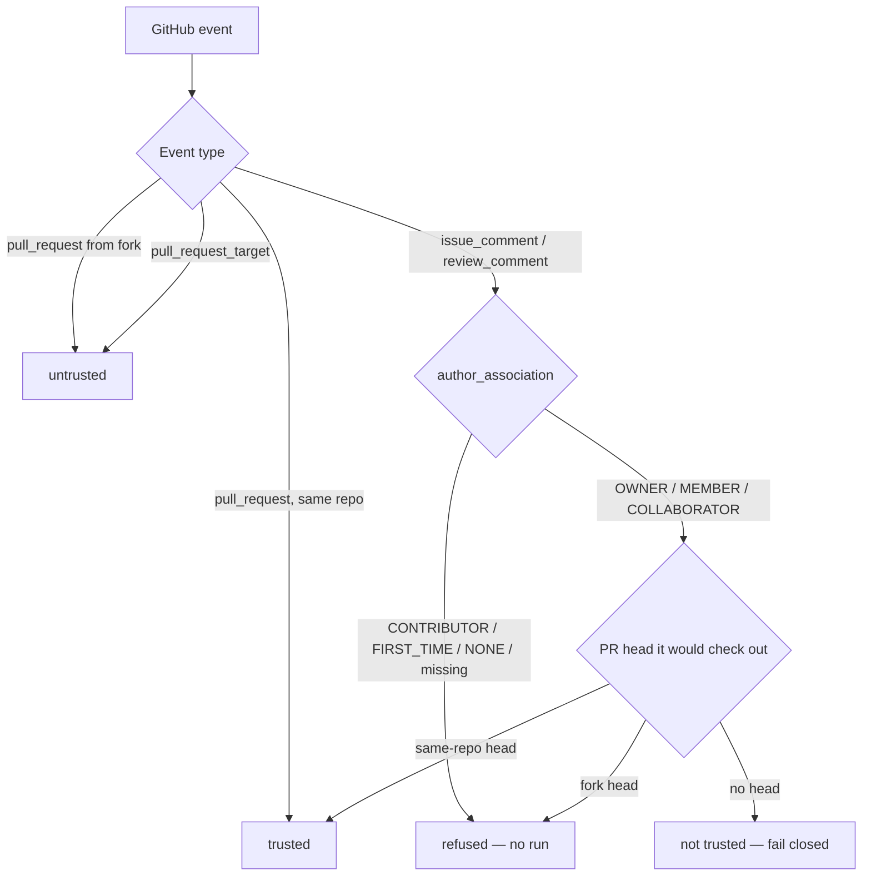

# Workflow examples and placement

Advanced workflow patterns, local review, and `pull_request_target` gotchas moved off the landing README.

<details>
<summary><b>Trust tiers & comment authorization</b> (click to expand)</summary>



The authorization decision reads `comment.author_association` from the event
payload — **never** the comment body — so writing `author_association: OWNER`
into a comment changes nothing. Who commented is only half of it: a
comment-triggered run is classified from **the code it would check out**, not
just who commented. The run binds the pull request it will review and reads the
head from the SCM API; a comment-triggered run with no PR head is not trusted,
and one on a fork PR is refused. Details:
[Comment-trigger authorization](#comment-trigger-authorization).

</details>

## Comment-trigger authorization

Only `OWNER`, `MEMBER`, and `COLLABORATOR` may start a run from an
`issue_comment` or `pull_request_review_comment`. The gate reads
`comment.author_association` from the GitHub event payload — never the
comment body. Under `pull_request_target`, comment triggers also require
`allow_pr_target_comments: true` on the Action input (default off). See
[`allow_pr_target_comments`](action-reference.md) in the action reference.

The run also binds the pull request it will check out **before** any trust or
credential decision, and reads the head from the SCM API rather than the comment.
A comment with no resolvable PR head is not trusted, and a comment-triggered run
on a fork PR is refused rather than downgraded. `checkout_pr` then refuses any PR
number other than the bound one, and refuses a fork head on a run trusted for
execution or authority.


### Example 2 — hardened, review as a required check

When the review gates merges, use `pull_request_target` with trust-aware
restrictions — [`examples/workflows/mergecraft-hardened.yml`](../examples/workflows/mergecraft-hardened.yml)
ships wait-for-CI, same-repo guards, and an enforce step that flips a `neutral`
approval check to blocking.

### Example 3 — local review before you push

```bash
mergecraft review                                        # uncommitted + branch changes vs origin/main
mergecraft review --base origin/main                     # this worktree vs that GitHub branch
mergecraft review --cwd ../feature-wt --base origin/main # linked worktree vs origin/main
mergecraft review --repo .                               # explicit local checkout
mergecraft review --repo owner/repo --head feature --base main   # public GitHub repo at a branch
mergecraft review --repo owner/repo --head pull/42/head --base main  # open or past GitHub PR
mergecraft review --repo https://github.com/o/r --token "$GH_TOKEN"  # private repo
mergecraft review --staged                               # staged changes only
mergecraft review --diff changes.patch --dry-run         # inspect the prompt, no LLM call
gh pr diff 42 > /tmp/pr-42.diff && mergecraft review --diff /tmp/pr-42.diff
mergecraft review --json findings.json                 # machine-readable Finding[] for scoring
mergecraft review --output-format sarif --output report.sarif.json
mergecraft review --output-format jsonl --output stream.jsonl
mergecraft review --agent                              # JSONL agent protocol on stdout
mergecraft review 2> review.md                         # human text is on stderr
```

Human-readable review text (default mode) is written to **stderr** so stdout stays free
for `--agent` JSONL and other machine payloads. Redirecting stdout (`mergecraft review > review.md`)
captures nothing useful — use `2>` instead (`mergecraft review 2> review.md`). Structured
findings still go to `--json` / `--output` paths as documented above. Root `--format json`
selects JSON output when `--output-format` is omitted (same pattern as `findings export`).

Process exit codes: `0` clean pass; `10` non-blocking findings; `11` blocking severities;
`12` review failed (no findings); `20` inconclusive; `30` configuration error; `40` infra error;
`50` timed out; `2` usage / invalid CLI input. Full table: [`docs/EXIT-CODES.md`](EXIT-CODES.md).

`diff-review` remains a hidden deprecated alias of `review` (one stderr warning per invocation).

**Auth precedence for private clones:** `--token` → `GH_TOKEN` / `GITHUB_TOKEN` →
`gh auth token` → anonymous (public repos only). Cloned third-party repositories
review at **untrusted** tier unless you pass an explicit `--trust trusted` override.

### Example 4 — multi-model with fallback

```yaml
# .mergecraft/config.yaml
models:
  - anthropic/claude-sonnet
  - openai/gpt-5.3-codex
  - google/gemini-3.1-pro-preview
modelFallbacks:
  anthropic/claude-sonnet:
    - anthropic/claude-opus
push: restricted
shell: restricted
staticChecks:
  - name: lint
    command: make lint
```

Add `model: <slug>` to the workflow `with:` block to pick the **head** of
the chain (default chain head is the first `models:` entry); the configured
fallbacks are walked on credential miss or retryable failure. See
[Chain semantics in authentication.md](authentication.md#chain-semantics--model) for the contract.

### Example 5 — SARIF upload to code scanning (opt-in)

Publish analyzer findings as GitHub code-scanning alerts — off by default,
requires `security-events: write`:

```yaml
permissions:
  contents: read
  pull-requests: write
  security-events: write   # required — without it GitHub answers 403

jobs:
  review:
    steps:
      - uses: alexhawat/mergeCraft@v0.1.0a1
        with:
          sarif_upload: enabled
```

Only findings admitted by the run's trust tier, `shell:` policy and
`analyzers:` mode are uploaded, after secret redaction — agent narrative is
never uploaded. Details: [docs/ANALYZERS.md](ANALYZERS.md).

Full config reference: [`examples/config.yaml`](../examples/config.yaml).

### Example 6 — Tracing with Logfire (opt-in)

Every run can emit a per-request span tree — to local JSONL, to
[Logfire](https://logfire.pydantic.dev/), or to any OTLP collector — off by
default:

```yaml
- uses: alexhawat/mergeCraft@v0.1.0a1
  with:
    tracing: enabled
    tracing-to: logfire
  env:
    LOGFIRE_TOKEN: ${{ secrets.LOGFIRE_TOKEN }}
```

One `trace_id` groups every span from a run into a single tree, so a
Logfire trace view of a real review reads top to bottom as:

```
mergecraft.run
└── agent.attempt          (per fallback entry: model.id, status, ...)
    ├── provider.call      (once per upstream API request)
    │   ├── http.client.request
    │   └── llm.call       (model.id, cost.*, gen_ai.usage.*)
    └── tool.call           (tool.name, tool.server)
```

`gen_ai.*` attrs on `llm.call` / `provider.call` follow the GenAI
semantic-convention keys, so Logfire's built-in AI panels group and render
them without extra config. Full config schema, the redaction guarantee, and
the payload/span-count caps: [docs/TRACING.md](TRACING.md).

<!-- Asset pending: a screenshot of this trace tree for a real review,
committed under docs/assets/ and linked here — operator-captured, see the
issues-showcase-readiness follow-up. -->

<span id="security-model"></span>

## 🔒 Security model

- **BYOK by design** — reviews call your configured model provider directly,
  with no mergeCraft-operated service in the path. If `jev.enabled: true` and
  `TYPESAFE_API_KEY` are set, Jev also sends review content to TypeSafe without
  redaction; see [Data sent to TypeSafe](jev-gate-patterns.md#data-sent-to-typesafe).
  The GitHub Action's PR review does not call Jev in this release.
- **Comment triggers are authorized, not authenticated-by-content** — only
  `OWNER`/`MEMBER`/`COLLABORATOR` associations can invoke; the body is never
  consulted. Two opt-in knobs (`allow_pr_target_comments`,
  `commentInvocationAllowlist`) each widen exactly one axis.
- **Learnings are fail-closed** — entries land in `## Staging`; only
  maintainer-associated authors promote to `## Active`, and active entries are
  nonce-fenced before the model reads them.
- **The approval check is structural** — `success` requires a completed trusted
  run with no Critical/Major findings; `failure` on any blocker; `neutral` for
  crashes, timeouts, and untrusted tiers. The agent's narrative approval is
  advisory only. This check is the merge gate; a formal APPROVE review needs
  `trust.selfReview: full` plus `prApproveEnabled` — see
  [trust policy](trust-policy.md).
- **Analyzers under low trust run untrusted-only** — no secrets, no network, no
  PR-authored command construction; exclusions are reported as named skips.
- **Agent subprocess env is an explicit name list, not a prefix allowlist** —
  agent CLIs never inherit the full process environment. GitHub Actions and
  runner metadata reach child processes by explicit documented name, so a
  lookalike credential variable cannot pass the default-deny filter. Stripped by
  default: ``GIT_ASKPASS``,
  ``GITHUB_TOKEN``/``GH_TOKEN``, ``ACTIONS_ID_TOKEN_*``, and every non-active
  provider API key. Git authentication for agent operations is brokered
  per-invocation via MCP git's ``http.extraHeader`` injection, not ambient
  askpass. Retained askpass files (entrypoint bookkeeping only) live at
  ``0o600`` inside a ``0o700`` credentials directory the agent cannot read.
  Run temp dirs and registered leak-surface paths are removed on success and
  failure; a cleanup that fails is logged as a warning naming the residual path
  and never the secret, and ``wipe_runner_leak_surface`` only unlinks
  mergeCraft-owned paths.
- **`push` / `shell` value semantics are defined in the action-inputs
  table** — see [Action inputs (`with:`) in action-reference.md](action-reference.md#action-inputs-with)
  for the `disabled` / `restricted` / `enabled` vocabulary both inputs share. `push` is
  **review-only** in production: mergeCraft refuses commit and push whatever its value, and no
  value grants write access.
- **Containment hardening** — ``safe.directory`` is scoped to
  ``$GITHUB_WORKSPACE`` and registered cross-repo checkout roots (no wildcard).
  Git hooks run only when ``shell: enabled``; ``restricted`` and ``disabled``
  neutralize hooks via ``core.hooksPath``. ``cwd`` and MCP shell
  ``working_directory`` must resolve inside allowed workspace roots. Agent CLI
  subprocesses **and the MCP shell** drop to the unprivileged ``mergecraft`` user
  via ``setpriv`` — and on a root orchestrator the analyzers drop to it too —
  while the action entrypoint stays root for GitHub file commands.
- **Network isolation depends on the sandbox backend** — on CI hosts that
  support it, untrusted MCP shell spawns with ``unshare --pid --net`` so the
  child has an empty network namespace. On macOS, ``sandbox-exec`` applies
  ``(deny network*)``. Where neither backend can isolate the network
  (restricted containers, missing CAP_SYS_ADMIN, no ``sandbox-exec``), shell
  egress is not kernel-isolated; the credential allowlist (no ambient
  ``GITHUB_TOKEN`` / provider keys / askpass) remains the binding control.
  Trusted-tier shell does not force ``--net`` so provider CLIs can still
  reach their APIs.

Report vulnerabilities via [SECURITY.md](../SECURITY.md). What a review does and
never does: [docs/REVIEW-CHECKS.md](REVIEW-CHECKS.md).

## ⚙️ Workflow-placement gotchas (`pull_request_target`)

GitHub resolves `pull_request_target` workflows from the **default branch** —
the workflow file *and* the checked-out commit, whatever base the PR targets
([Nov 2025 policy](https://github.blog/changelog/2025-11-07-actions-pull_request_target-and-environment-branch-protections-changes/),
effective 2025-12-08). Three consequences:

- **A copy on a non-default trunk is inert.** If `main` is a stub and real work
  lands on a staging branch, this workflow still has to live on `main`.
- **`GITHUB_REF` / `GITHUB_SHA` point at the default branch**, not the PR base —
  so a bare `actions/checkout` lands on default-branch tip and
  `.mergecraft/config.yaml` is read from there. Environment branch-protection
  rules also now evaluate against the default branch; update environment
  filters if you gate secrets that way.
- **A PR that edits this workflow is still reviewed — by the default-branch
  copy.** Its own edits apply to the *next* PR, after merge. (That much was
  always true of `pull_request_target`; what Nov 2025 changed is base branch →
  default branch.)

If the review is **not** a required check, prefer plain `pull_request` — simpler,
and no secrets in scope. The case for accepting `pull_request_target` is narrower
than it looks: GitHub cannot build `refs/pull/N/merge` for a conflicted PR, so
`pull_request` runs are skipped and a *required* review check sits unreported
for as long as the conflict lasts. `pull_request_target` still fires on
`synchronize` in that state, so the review lands — and its verdict is visible —
while the PR is still conflicted.

That is the whole of the benefit, and it is worth stating plainly: pushing the
conflict fix to the PR branch fires `synchronize` and clears a `pull_request`
check too, so the gap is the conflicted window, not a permanent block. It
outlasts the conflict only when the conflict disappears *without* a push to the
head branch — the base moved, say — because nothing then re-triggers the run.
A conflicted PR is unmergeable on its own account anyway, so weigh this against
running with secrets in scope rather than treating it as decisive.

## Action pin and evidence artifacts

Pin `uses: alexhawat/mergeCraft@…` to a full commit SHA or a release tag
([distribution](distribution.md)). `uses:` accepts no expressions, so it cannot
read an `env:` value; write the literal ref on every step. If a workflow uses
the Action in several steps, you can record the canonical ref in a
workflow-level `env:` entry and have a CI check compare each literal `uses:`
against it.

After each review rung, the workflow persists the `evidence_packet` action output
to disk and uploads it as an artifact (`if: always()`):

```yaml
- name: Persist evidence packet
  if: always()
  env:
    PACKET: ${{ steps.mergecraft_codex.outputs.evidence_packet }}
  run: printf '%s' "$PACKET" > packet-codex.json

- uses: actions/upload-artifact@<full-sha>
  if: always()
  with:
    name: mergecraft-evidence-codex
    path: packet-codex.json
    retention-days: 30
    if-no-files-found: ignore
```

The `env:` indirection is mandatory — interpolating the packet directly into a
`run:` body puts it in the process table and re-renders it into the log. The
packet is also written to `$GITHUB_OUTPUT` by the Action and consumed in-process
for fallback routing; the artifact is what survives after the runner is recycled.

When you gate pin copies against each other, read the workflow side from the
**default branch** (`git show origin/main:.github/workflows/mergecraft.yml`), not
the working tree. Bump order is default branch first, local pin second.

Since [June 2026](https://github.blog/changelog/2026-06-18-safer-pull_request_target-defaults-for-github-actions-checkout/)
`actions/checkout` refuses to check out fork PR code under `pull_request_target`
unless you pass `allow-unsafe-pr-checkout` (v7 GA 2026-06-18, backported to all
supported majors 2026-07-20). mergeCraft's shipped workflows are unaffected —
they check out the default branch with no `ref:` and reach PR content through
`checkout_pr` and the API, never by executing PR-authored code with secrets in
scope.

Full rationale in the collapsible sections of
[documentation index](README.md).

### Approval

mergeCraft posts a COMMENT review plus the `mergecraft review` status check; the
check is the merge gate. A formal APPROVE needs both authority trust (`trust.selfReview: full`) and
`prApproveEnabled: true`. See [trust policy](trust-policy.md#approval-and-the-merge-gate)
and [App setup](authentication.md#reviewer-app-identity). How this
repository runs its own self-review is in
[`docs/dev/self-review.md`](dev/self-review.md).

## Ignoring paths

Two layers, and you usually want both. A workflow-level `paths-ignore` skips the
run when **every** changed file matches; the `ignore_paths` input trims a **mixed**
pull request, so the reviewer never reads eval data or changelogs it has no
opinion on. Changes to the [README example](../README.md#example-1--auto-review-every-pr):

```yaml
on:
  pull_request:
    types: [opened, ready_for_review, synchronize]
    # Skip the whole run when only these files change.
    paths-ignore:
      - "host/evals/**/*.jsonl"
      - "CHANGELOG.md"
# ...
      - uses: alexhawat/mergeCraft@7080e962c2259757a34b9f745602f093e4ee3378 # v0.1.0a4
        with:
          # Leave these out of the diff the reviewer sees on a mixed PR.
          # Newline- or comma-separated globs; `**` crosses directories.
          ignore_paths: |
            host/evals/**/*.jsonl
            CHANGELOG.md
```

Ignored files are listed in the review under "Not reviewed (ignored by config)",
and a pull request whose every changed file is ignored passes quickly with
"nothing to review", leaving approval to a human. Changelogs (`**/CHANGELOG.md`),
lockfiles (`**/*.lock`, `**/package-lock.json`) and minified files are ignored by
default (a `generated/` directory is reviewed unless `**/generated/**` is added); `review.ignorePaths` in `.mergecraft/config.yaml` adds
globs, and `review.ignorePathDefaults: false` reviews the defaults again. A
renamed file is ignored only when both its old and new names match. The
config is read from the base branch only, so a pull request cannot opt its own
files out of review. If `mergecraft` or `mergecraft-approval` is a required check,
rely on `ignore_paths` alone: a run that `paths-ignore` skips never reports either check.

## Drafts and automatic review frequency

The workflow generated by `mergecraft init` sends `opened`, `synchronize`, and
`ready_for_review` events to the Action. By default, the Action skips drafts,
reports neutral checks when status checks are enabled, and reviews a PR when
it becomes ready. Ready PRs receive a review on every push by default.

Configure the policy in the base branch's `.mergecraft/config.yaml`:

```yaml
review:
  drafts: skip
  triggers:
    frequency: everyPush
```

- `review.drafts` accepts `skip`, `lite`, and `full`. Lite uses the capped
  `review.fastPath.lite` provider configuration and never grants approval.
  Enable and configure that provider to run lite on drafts. If the diff or
  capped call is unavailable, the Action skips the draft without escalating.
- `review.triggers.frequency` accepts `everyPush`, `oncePerPr`, and
  `onRequest`. With `oncePerPr`, a push is skipped only after a verified
  mergeCraft review has completed, including a formal review published as a
  comment with a successful deterministic run record. Opening, reopening, and
  marking the PR ready still trigger a review if the workflow sends those
  events. Missing or unverifiable review history allows a review.
  `onRequest` suppresses automatic PR reviews, including ready events.

The Action reads these settings from the base checkout for
`pull_request_target` and the pinned base commit for `pull_request`. If it
cannot read the base settings, it uses the defaults. Authorized manual
dispatches and comment requests follow their existing authorization and
bypass automatic draft and frequency policy. Comment triggers remain opt-in.

Policy applies when the workflow invokes the Action. The hardened example
filters drafts before invoking it. To use lite or full draft reviews with
that workflow, adjust its draft filter and account for the approval gate's
handling of neutral results.
